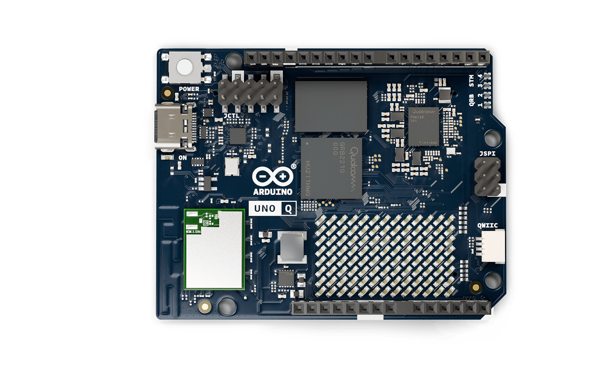
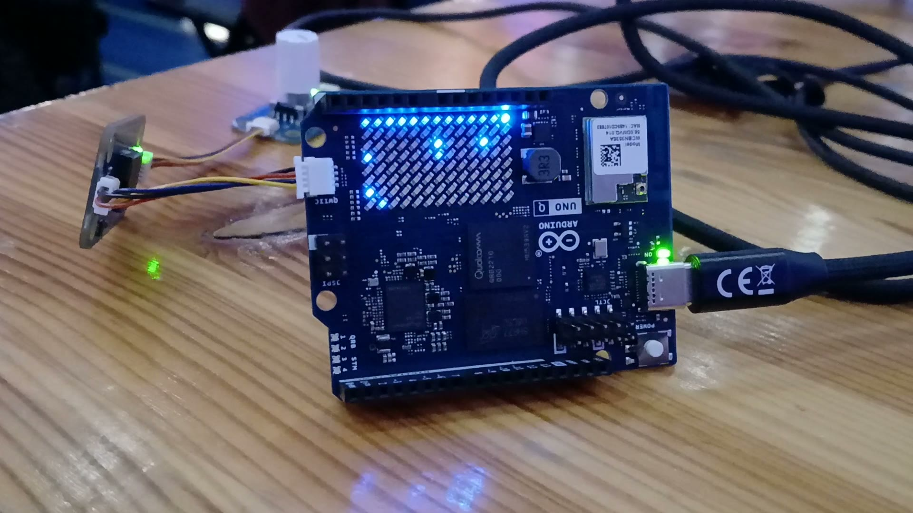
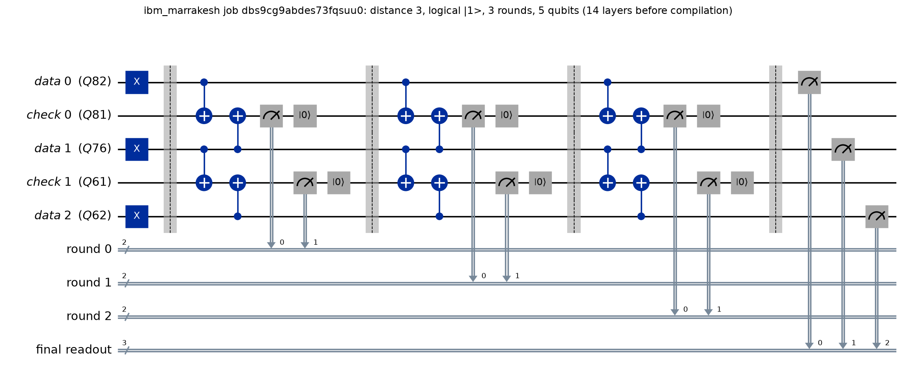
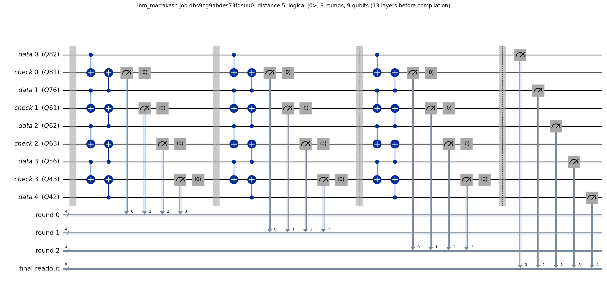
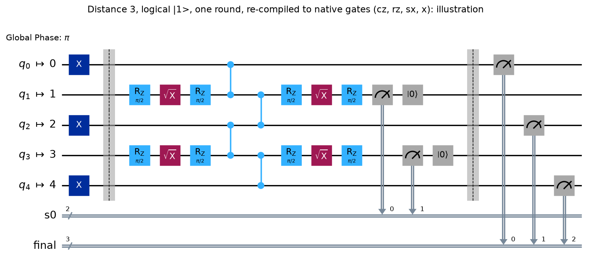
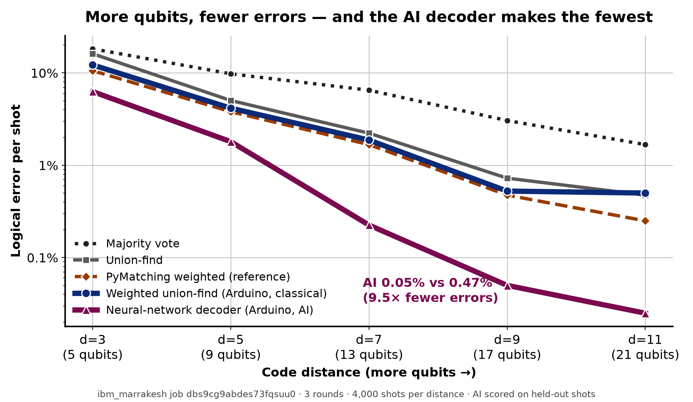
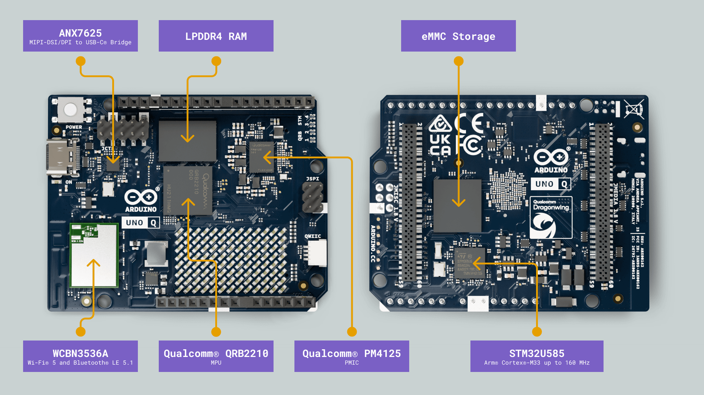

# QEC Edge Lab: repetition-code memory experiments decoded on an Arduino UNO Q

Bit-flip repetition-code **memory experiments** run on IBM Heron processors, decoded on a 160 MHz microcontroller
(the STM32U585 of an Arduino UNO Q), with cycle-accurate timing of each decoder and a real-time replay test.

This page assumes you know the basics of quantum error correction: stabilizers, syndromes, the repetition code and
the idea of a decoding graph; union-find and matching decoders are described briefly but not derived. If you want the plain-language version written for the Junction Finland 2026
hackathon, see the [`junction_submission`](https://github.com/victor-onofre/QEC_Edge_Lab_submission/tree/junction_submission) branch, which keeps the submission as it was.

- Demo video (2 min): https://www.youtube.com/watch?v=pFP3tOLFYHk
- Interactive demo on real shots: https://victor-onofre.github.io/QEC_Edge_Lab_submission/demo/
- Slides: [`presentation/`](presentation/) · Next steps: [`ROADMAP.md`](ROADMAP.md)

| The board (official image) | Our setup during a run |
|---|---|
|  |  |

Left: Arduino UNO Q, image © Arduino, CC BY-SA 4.0 ([source and attribution](media/arduino/ATTRIBUTION.md)).
Right: the board used for this project, with a Modulino Knob and Buzzer on the Qwiic connector.

> **Correction to the hackathon claim (November 2026).** The submission said that an on-device neural network makes
> "up to 9.5× fewer errors than the best classical decoder". That comparison is misleading. Decoders that look only at
> the final data readout and ignore every syndrome (a threshold on the number of 1s, or a per-qubit naive-Bayes rule)
> beat every graph decoder on ibm_fez at every distance where the graph decoders still fail (d ≤ 11), and match or
> beat the network except at the smallest distances (d = 3 on ibm_fez, d ≤ 7 on ibm_marrakesh). The network mostly
> learned the state-dependent decay of |1⟩ and which qubits to distrust, which the graph decoders were never told.
> See [section 5.3](#53-the-neural-decoder-and-what-it-actually-learns). The video, the slides, the demo page and
> [`results/results_tables.md`](results/results_tables.md) still carry the original wording.

## Summary

| | |
|---|---|
| Experiment | Z-basis memory of the bit-flip repetition code, d = 3…25 (5…49 qubits), 3 syndrome rounds, logical \|0⟩ and \|1⟩ |
| Hardware | ibm_fez and ibm_marrakesh (Heron r2, 156 qubits), IBM Open Plan; ~6 s of QPU time per 16-circuit job |
| Statistics | 2,000 shots per logical state, so 4,000 per distance and run; 4 runs; no shots are post-selected |
| Decoders on the STM32 | majority vote, greedy matching, union-find (naive, fast, weighted), and a small neural network (MLP: a multi-layer perceptron with one hidden layer, integer weights) |
| Reference decoders (laptop) | PyMatching: uniform, weights per logical state, weights from both states mixed |
| Error suppression | ibm_fez: weighted union-find 4.8% at d=3 → 0.075% at d=11 (193 → 3 failures in 4,000) |
| Decode time on the STM32 | fast union-find 7.7 µs (d=3) to 62 µs (d=25) per shot; MLP 11.9 µs (d=3), 16.8 µs (d=5) |
| Real-time replay | d=5: MLP and weighted union-find have a limit τ* ≈ 8.7 µs per round; both kept up at the tested τ = 10 µs |
| Other platforms | About 10× too slow for the fastest superconducting cycles; a margin of about 100× or more on millisecond-scale rounds (neutral atoms, trapped ions), for these small 1-D codes only ([section 6](#6-slower-platforms-neutral-atoms-and-trapped-ions)) |

## 1. What this is: a memory experiment

A memory experiment asks one question: **if a logical state is prepared and then left alone under repeated syndrome
extraction, how often is the logical value wrong at the end?** There are no logical gates. The logical qubit only
has to survive.

**Code.** The bit-flip repetition code on d data qubits has stabilizers Z<sub>i</sub>Z<sub>i+1</sub> (i = 0…d−2).
Logical Z is a single Z on any data qubit; logical X is X on all d of them. The code has distance d against X errors
and distance 1 against Z errors, so it protects a classical bit of quantum information: it corrects bit flips and
does nothing about phase flips. It is not a full logical qubit.

**Protocol (one shot).**

1. **Prepare** all data qubits in |0⟩ (logical |0⟩) or all in |1⟩ (logical |1⟩). Both are +1 eigenstates of every stabilizer.
2. **Repeat R = 3 times:** entangle each ancilla with its two neighbouring data qubits (two CX layers), measure the
   ancilla to read Z<sub>i</sub>Z<sub>i+1</sub>, then reset it.
3. **Measure all data qubits** in the Z basis. The parities of neighbouring data bits give one more round of
   stabilizer values with no ancilla measurement error (a data readout error appears in it as a pair of space-like
   detections), and data qubit 0 gives the raw logical readout.
4. **Decode offline:** from the syndrome history, decide whether the readout of data qubit 0 must be flipped. The shot
   is a failure if the corrected value differs from the prepared one.

**What is measured** is the logical error probability per shot after 3 rounds, for each distance and decoder.
With only 3 rounds we do not extract an error rate per round or the suppression factor Λ (the factor by which the
logical error per round drops when d increases by 2); that needs a sweep in R (see the roadmap).

**What a memory experiment does not show.** The correction is a Pauli-frame update: the decoder's X corrections are
tracked classically and applied to the measured result, and nothing is fed back to the qubits. Because the data start in a computational-basis state, the final
data readout carries direct information about the prepared state (section 5.3 is entirely about this). And the
prepared state is known, which is what makes training labels available.

## 2. The circuits

The circuit builder is `rep_code_circuit(d, rounds, truth)` in [`code/qec_lab/python/main.py`](code/qec_lab/python/main.py).
Qubits alternate data, ancilla, data, … along a line of 2d−1 physical qubits, found on the coupling map so that no
SWAP gates are needed. Each job holds 16 circuits (8 distances × 2 logical states), transpiled at optimisation level 1,
with no dynamical decoupling, and run with `SamplerV2`.

The pictures below are generated by [`code/qec_lab/tools/draw_circuits.py`](code/qec_lab/tools/draw_circuits.py), which
takes the builder verbatim from the app and the physical qubits from the run's metadata. They show what was
submitted, before IBM-specific compilation.

**Distance 3, logical |1⟩, 3 rounds** (ibm_marrakesh, job `dbs9cg9abdes73fqsuu0`, physical qubits 82, 81, 76, 61, 62):



**Distance 5, logical |0⟩, 3 rounds** (same job, physical qubits 82, 81, 76, 61, 62, 63, 56, 43, 42):



The same structure for one round at distance 3, as text:

```
         ┌───┐ ░                         ░ ┌─┐
 data 0: ┤ X ├─░───■─────────────────────░─┤M├──────
         └───┘ ░ ┌─┴─┐┌───┐┌─┐           ░ └╥┘
check 0: ──────░─┤ X ├┤ X ├┤M├─|0>───────░──╫───────
         ┌───┐ ░ └───┘└─┬─┘└╥┘           ░  ║ ┌─┐
 data 1: ┤ X ├─░───■────■───╫────────────░──╫─┤M├───
         └───┘ ░ ┌─┴─┐┌───┐ ║  ┌─┐       ░  ║ └╥┘
check 1: ──────░─┤ X ├┤ X ├─╫──┤M├──|0>──░──╫──╫────
         ┌───┐ ░ └───┘└─┬─┘ ║  └╥┘       ░  ║  ║ ┌─┐
 data 2: ┤ X ├─░────────■───╫───╫────────░──╫──╫─┤M├
         └───┘ ░            ║   ║        ░  ║  ║ └╥┘
round 0: ═══════════════════╩═══╩═══════════╬══╬══╬═
  final: ═══════════════════════════════════╩══╩══╩═
```

On a Heron chip each CX becomes a CZ between Hadamard-like single-qubit rotations on the ancilla. This is a local
re-compilation for illustration, not the stored job circuit:



Three features of this circuit matter for the results:

- **Data qubits idle while the ancillas are measured and reset.** Measurement is the slowest operation on these chips,
  so a data qubit in |1⟩ spends most of each round exposed to T1 decay. This is the likely origin of the
  state-dependent noise in section 5.2. We did not record gate, measurement and reset durations or the qubits' T1, so
  the size of the effect is not checked against calibration; measurement-induced decay or crosstalk could contribute.
- **The two CX layers are not simultaneous.** Data qubit k couples to ancilla k in the first layer and to ancilla k−1
  in the second, so an X error on an interior data qubit between its two CXs fires detectors (t, k−1) and (t+1, k):
  a diagonal, space-time edge. Our decoding graph has no diagonal edges, so such
  an error is matched through a space edge plus a time edge.
- **Ancillas are reset actively**, so each syndrome bit is the stabilizer value itself, not a running parity.

## 3. From measurements to a decoding problem

**Shot layout.** One shot is R(d−1) syndrome bits s<sub>t,i</sub> followed by d data bits x<sub>k</sub>.

**Detection events.** With s<sub>R,i</sub> = x<sub>i</sub> ⊕ x<sub>i+1</sub> (the stabilizer values implied by the final
readout) and s<sub>−1,i</sub> = 0, the detectors are

D<sub>t,i</sub> = s<sub>t,i</sub> ⊕ s<sub>t−1,i</sub>, for t = 0…R and i = 0…d−2.

**Decoding graph.** Nodes are the (R+1)(d−1) detectors plus one boundary node.

| Edge | Connects | Fault it represents |
|---|---|---|
| Space | (t, i) – (t, i+1), every t | X error on data qubit i+1 before round t; at t = 0 also a preparation error, at t = R also a readout error |
| Boundary | (t, 0) – B and (t, d−2) – B, every t | The same for data qubit 0 or d−1 |
| Time | (t, i) – (t+1, i) | Measurement error on ancilla i in round t (a failed reset looks similar) |

The logical observable is the final value of data qubit 0, so a correction flips it once for every left-boundary
edge it contains. Code: `qec::configure` in [`sketch/qec_decoders.h`](code/qec_lab/sketch/qec_decoders.h) and
`build_graph` in [`python/qec_common.py`](code/qec_lab/python/qec_common.py) (same edge order in both).

**Edge probabilities from the data.** The Linux side estimates the probability of each bulk edge from pairwise
detector correlations (the "p<sub>ij</sub>" method used in repetition-code experiments [8]):

p<sub>ij</sub> = ½ − ½ √( 1 − 4(⟨x<sub>i</sub>x<sub>j</sub>⟩ − ⟨x<sub>i</sub>⟩⟨x<sub>j</sub>⟩) / (1 − 2⟨x<sub>i</sub>⟩ − 2⟨x<sub>j</sub>⟩ + 4⟨x<sub>i</sub>x<sub>j</sub>⟩) )

Boundary-edge probabilities follow from each detector's marginal rate after removing its bulk edges. The estimate
is made **separately for logical |0⟩ and |1⟩**, because the two see very different data noise. Weights are
w = ln((1−p)/p); for the microcontroller they are rounded to integer growth capacities, round(2w / median w),
clipped to 1…15 and packed 4 bits per edge.

## 4. Decoders

| Decoder | Where | Uses syndromes | Noise knowledge | Notes |
|---|---|---|---|---|
| Majority vote | STM32 | No | None | Baseline: majority of the final data bits |
| Greedy matching | STM32 | Yes | None | Repeatedly pairs the closest detectors (Manhattan distance) or a detector with the nearer boundary |
| Union-find, naive | STM32 | Yes | None | Delfosse–Nickerson [6] cluster growth by half-edges, then peeling on a spanning forest |
| Union-find, fast | STM32 | Yes | None | Same answers; early exit on empty syndromes, lazy per-shot reset, growth visits only the vertices of active clusters |
| Union-find, weighted | STM32 | Yes | p<sub>ij</sub> per edge, per logical state | Integer capacity per edge; capacity 2 everywhere reproduces the unweighted decoder |
| MLP (multi-layer perceptron) | STM32 | Yes, plus the final data bits | Learned from labelled shots | (R+1)(d−1) + d binary inputs → 32 ReLU → 1 output: flip data qubit 0 or not |
| MWPM (PyMatching [7]) | Laptop | Yes | None, per-state p<sub>ij</sub>, or mixed-state p<sub>ij</sub> | Reference; "mixed" is the fair, label-free baseline |

The laptop tool [`tools/qec_offline.py`](code/qec_lab/tools/qec_offline.py) compiles the same C decoder files that run on
the STM32, so the error rates below are what the microcontroller's code produces.

**MLP details.** Trained in numpy on the board's Linux side (logistic loss, Adam, 2,000 steps, batch 128, ~2.6 s per
model), one network for both logical states. The prepared state is only the label. Weights are quantised to 15-bit
integers and sent to the STM32, where the first layer is additions only (inputs are bits) and inference is bit-exact
with the Python model on every shot tested; about 8.5 KB of RAM. Reported error rates use 2-fold cross-fitting: the
shots are split in two halves, a model trained on one half (2,000 shots) decodes the other, and vice versa, so every
shot is decoded by a model that did not see it.

## 5. Results

Failures out of 4,000 shots per distance (2,000 per logical state). Runs: **fez-1** `dbs8m78k09pc73avsgh0`,
**fez-2** `dbs8pivv5hds73dim45g`, **fez-3** `dbsa8iok09pc73avu6bg`, **marrakesh** `dbs9cg9abdes73fqsuu0`. All four used
the same line of physical qubits (82, 81, 76, 61, 62, 63, 56, 43, 42, …). Weighted decoders are cross-fitted on two
halves. With this sample size, small counts carry wide uncertainty: the 95% Wilson confidence interval is 0.03–0.22%
for 3 failures and 0.30–0.74% for 19.

### 5.1 Error suppression with distance

**ibm_fez (fez-2)**

| d | Qubits | Majority | Union-find | Weighted UF | MWPM | MWPM, per-state weights | MWPM, mixed weights |
|---|---|---|---|---|---|---|---|
| 3 | 5 | 206 | 194 | 193 | 222 | 181 | 194 |
| 5 | 9 | 80 | 61 | 43 | 61 | 44 | 39 |
| 7 | 13 | 32 | 26 | 23 | 28 | 16 | 19 |
| 9 | 17 | 19 | 11 | 7 | 9 | 4 | 5 |
| 11 | 21 | 10 | 3 | 3 | 4 | 3 | 3 |
| 15 | 29 | 3 | 0 | 0 | 0 | 0 | 0 |
| 21, 25 | 41, 49 | 0 | 0 | 0 | 0 | 0 | 0 |

**ibm_marrakesh**

| d | Qubits | Majority | Union-find | Weighted UF | MWPM | MWPM, per-state weights | MWPM, mixed weights |
|---|---|---|---|---|---|---|---|
| 3 | 5 | 730 | 645 | 488 | 677 | 423 | 491 |
| 5 | 9 | 391 | 201 | 166 | 207 | 152 | 144 |
| 7 | 13 | 260 | 89 | 75 | 98 | 67 | 80 |
| 9 | 17 | 122 | 29 | 21 | 26 | 19 | 21 |
| 11 | 21 | 67 | 19 | 20 | 17 | 10 | 8 |
| 15 | 29 | 72 | 6 | 17 | 6 | 7 | 2 |
| 21 | 41 | 27 | 2 | 2 | 0 | 1 | 0 |
| 25 | 49 | 13 | 0 | 0 | 0 | 0 | 0 |

The logical error falls overall with distance on both chips for every decoder (not monotonically at every step:
on ibm_marrakesh majority vote goes from 67 to 72 failures between d = 11 and 15).

**The ibm_marrakesh numbers are dominated by a bad qubit that is also the logical observable.** On that chip, data
qubit 0 (physical qubit 82) reads 1 in about 26% of the logical-|0⟩ shots and 29% of the logical-|1⟩ shots, at every
distance: its readout carries almost no information. Since the observable is defined as the value of data qubit 0,
the marrakesh comparison mostly measures how well a decoder copes with a dead observable qubit. The line of qubits
is chosen by a seeded random walk on the coupling map (`find_line`), not from calibration data, so the same line was
used on both chips. On ibm_fez the same qubit reads correctly in |0⟩ (about 1% read as 1) but is among the worst in
|1⟩ (18–29% of shots read 0, against a median of 13–15%). At d ≥ 15 the ibm_marrakesh line contains a second nearly
dead qubit (data qubit 11, physical qubit 26), which reads 1 in only 8–9% of the logical-|1⟩ shots.




Both charts are drawn by [`tools/plot_results.py`](code/qec_lab/tools/plot_results.py) and include the two readout-only
baselines of section 5.3 (green). Notes for reading them:

- They show d = 3…11 only. At d ≥ 15 the graph decoders reach 0 failures, while the threshold rule and the MLP do not.
- A hollow marker in the grey band means 0 failures in 4,000 shots (95% upper bound about 0.1%). There are no error bars.
- On ibm_fez the threshold and naive-Bayes rules give identical counts, so the two green lines coincide.
- "Weighted union-find" uses per-state weights, which rely on the prepared state; "MWPM, mixed weights" does not.

### 5.2 State-dependent noise

Edge probabilities estimated per logical state from the d = 25 shots (p<sub>ij</sub> method). "Data" is the median
over the 25 data qubits; layer 0 is the edge layer before the first syndrome round, layers 1–3 each follow a full round.

| Chip | State | Data, layer 0 | Data, layers 1 / 2 / 3 | Data, mean of layers | Measurement |
|---|---|---|---|---|---|
| ibm_fez (fez-2) | \|0⟩ | 0.22% | 0.07% / 0.03% / 0.27% | 0.17% | 3.7% |
| ibm_fez (fez-2) | \|1⟩ | 0.60% | 4.4% / 4.7% / 5.2% | 4.0% | 3.6% |
| ibm_marrakesh | \|0⟩ | 0.60% | 0.15% / 0.31% / 0.68% | 0.40% | 1.9% |
| ibm_marrakesh | \|1⟩ | 0.90% | 8.1% / 7.8% / 8.9% | 7.2% | 1.6% |

- **A data qubit in |1⟩ flips roughly 20 times more often than one in |0⟩,** in the per-qubit median (18× and 24×
  from the table). The |0⟩ values are small and close to the estimator's lower clip, so the ratio is imprecise;
  averaged over each code instead, the ratio stored with the board results is 5–14 on ibm_fez and 3–7 on
  ibm_marrakesh. (`results/results_tables.md` quotes 19× and 16× from an earlier estimate with different medians.)
- **The excess appears only after a full round.** Layer 0 is below 1% for both states; layers 1–3 jump to 4–9% for
  |1⟩. That is what decay during the ancilla measurement and reset would produce.
- **Almost all logical failures are logical-|1⟩ shots.** Majority vote at d = 3: 0 failures on |0⟩ and 206 on |1⟩
  (fez-2); 40 and 690 on ibm_marrakesh.

This breaks the assumption behind matching and union-find on this graph, where an edge has one probability whatever
the data state. Data-derived weights help relative to uniform ones, but per-state weights, which use knowledge of
the prepared state, are not consistently better than label-free mixed weights, except at d = 3 (tables in 5.1).

### 5.3 The neural decoder and what it actually learns

The MLP sees the detection events **and the final data bits**. In a Z-basis memory experiment with |1⟩ → |0⟩ decay,
the final data bits alone are a strong, asymmetric estimator of the prepared state: surviving 1s are evidence for
logical |1⟩, while a few 0s are weak evidence for logical |0⟩. To separate that from anything learned from the
syndromes, compare with two decoders that use **only the final data bits**:

- **Threshold:** logical 1 if the number of 1s reaches a threshold (one parameter).
- **Naive Bayes:** one probability per data qubit and logical state, so it can also learn which qubits to distrust.

Both are fitted on one half of the shots and scored on the other, with the same split as the MLP. "Best graph
decoder" is the lowest count among union-find, weighted union-find and the three PyMatching variants, including the
per-state ones that use the label, so it is generous to the graph decoders.

| Run | d | Majority | Best graph decoder | Threshold (final bits) | Naive Bayes (final bits) | MLP |
|---|---|---|---|---|---|---|
| fez-2 | 3 | 206 | 181 | 108 | 108 | **77** |
| fez-2 | 5 | 80 | 39 | **4** | **4** | 20 |
| fez-2 | 7 | 32 | 16 | **0** | **0** | 9 |
| fez-2 | 9 | 19 | 4 | **0** | **0** | 9 |
| fez-2 | 11 | 10 | 3 | **0** | **0** | 12 |
| fez-3 | 5 | 108 | 56 | **14** | **14** | 20 |
| fez-3 | 7 | 69 | 25 | 2 | **1** | 9 |
| marrakesh | 3 | 730 | 423 | 730 | 311 | **251** |
| marrakesh | 5 | 391 | 144 | 181 | 104 | **72** |
| marrakesh | 7 | 260 | 67 | 65 | 20 | **9** |
| marrakesh | 9 | 122 | 19 | 13 | **2** | **2** |
| marrakesh | 11 | 67 | 8 | 3 | 2 | **1** |

Reading:

- **On ibm_fez, ignoring the syndromes beats every graph decoder at every distance where they still fail (d ≤ 11),**
  and beats the MLP for d ≥ 5. At d ≥ 15 the graph decoders and naive Bayes are at 0 of 4,000, while the threshold
  rule shows a few failures (1 at d = 15 and 3 at d = 25 on fez-2) and the MLP sits at 0.15–0.43%. That MLP floor is
  a training artefact: more inputs, the same 2,000 training shots per fold.
- **On ibm_marrakesh the threshold is not enough** (it loses to the graph decoders at d = 3 and 5), because one data
  qubit is uninformative. Naive Bayes, which can learn that, gets most of the way to the MLP: the 9.5× of the
  hackathon write-up (19 failures against 2 at d = 9) is matched exactly without any syndrome.
- **The syndromes add a measurable gain to the MLP only at small distance:** d ≤ 7 on ibm_marrakesh and d = 3 on
  ibm_fez. There the MLP also beats the best possible lookup table on the final bits alone (an in-sample bound: 108
  failures at d = 3 on fez-2, and 311 / 102 / 17 at d = 3 / 5 / 7 on ibm_marrakesh), so the gain does come from the syndromes. So the ratio "MLP against the best graph decoder" mostly measures a state prior and per-qubit readout
  statistics that the graph decoders lack, not learning of error correlations.
- **The effect is specific to this experiment.** It needs data in a product state whose readout reveals the logical
  value, plus strongly biased decay. With a hidden random X-frame on the data, or in the phase-flip code, the
  shortcut is gone. The roadmap's first steps are these controls and far more shots.

Related work, reported to use about 700 times more data: a neural repetition-code decoder on IBM hardware [9].

### 5.4 Decoder cost on the STM32

Mean CPU cycles per shot at 160 MHz, measured with the Cortex-M cycle counter (DWT) with interrupts masked, 400 shots
per distance, run fez-2. The majority column includes the detector computation shared by all decoders; the other
columns exclude it.

| d | Majority | Greedy | UF naive | UF fast | UF weighted | UF fast (µs) | Fast vs naive |
|---|---|---|---|---|---|---|---|
| 3 | 411 | 283 | 3,008 | 1,232 | 1,192 | 7.7 | ×2.4 |
| 5 | 689 | 570 | 5,951 | 2,280 | 2,214 | 14.2 | ×2.6 |
| 7 | 967 | 870 | 9,016 | 3,140 | 3,108 | 19.6 | ×2.9 |
| 9 | 1,245 | 1,259 | 12,328 | 4,022 | 3,824 | 25.1 | ×3.1 |
| 11 | 1,523 | 1,640 | 15,480 | 4,636 | 4,732 | 29.0 | ×3.3 |
| 15 | 2,079 | 2,917 | 22,497 | 6,368 | 6,438 | 39.8 | ×3.5 |
| 21 | 2,913 | 5,466 | 32,728 | 8,300 | 8,391 | 51.9 | ×3.9 |
| 25 | 3,469 | 7,714 | 39,642 | 9,902 | 10,247 | 61.9 | ×4.0 |

On the noisier ibm_marrakesh data the fast version gains ×1.6–3.2, because fewer shots have empty syndromes.
The naive and fast union-find agree on every shot. MLP, measured on run fez-3: 1,909 cycles (11.9 µs) at d=3,
2,686 (16.8 µs) at d=5, 4,974 (31 µs) at d=11, 10,246 (64 µs) at d=25.

### 5.5 Real-time replay

4,000 shots are bulk-loaded into STM32 RAM and replayed as if one syndrome round arrived every τ, with interrupts
on. The STM32 decodes in order and records backlog and latency. The limit is τ* = mean decode time / R, where the
decode time includes detector computation but not unpacking the shot from memory, so τ* is slightly optimistic.

**ibm_marrakesh, d = 5**

| Decoder | Mean decode in replay | τ* | Kept up at (max backlog) | Fell behind at (max backlog) |
|---|---|---|---|---|
| MLP | 26.0 µs | 8.7 µs | 10 µs (30) | 5.6 µs (2,214) |
| UF weighted | 25.9 µs | 8.6 µs | 10 µs (47) | 5.6 µs (2,219) |
| UF fast | 31.0 µs | 10.4 µs | 17.8 µs (15) | 10 µs (456) |
| UF naive | 59.3 µs | 19.8 µs | 31.6 µs (8) | 17.8 µs (523) |

**ibm_fez (fez-2), d = 11:** UF fast τ* = 14.8 µs, UF weighted 15.5 µs, UF naive 41 µs. Near the limit (83% busy)
the p99 latency is already 1.2 ms. Decode time inside the replay is about 1.5× the isolated measurement, because it
includes detector computation (part of the 1,523 cycles, 9.5 µs, of the majority column at d=11), which the other
isolated figures exclude, and interrupts.

What these limits mean for different hardware platforms is discussed in [section 6](#6-slower-platforms-neutral-atoms-and-trapped-ions).

All tables: [`results/results_tables.md`](results/results_tables.md). Raw shots: [`data/ibm_runs/`](data/ibm_runs/).

## 6. Slower platforms: neutral atoms and trapped ions

A decoder is fast enough when its throughput exceeds the rate at which syndromes arrive; otherwise the backlog grows
without bound, which is what the replay test shows. So the relevant hardware number is the duration of one
syndrome-extraction round.

| Platform | Typical round | Our measured limit τ* | Ratio |
|---|---|---|---|
| Superconducting (fastest reported cycles) | ~1 µs [1] | 8.7 µs (d=5), 14.8 µs (d=11) | 0.1×: about ten times too slow |
| Neutral atoms | 4.45 ms per round in a recent experiment [10] | same | ~500× (d=5), ~300× (d=11) |
| Trapped ions | a millisecond or more [12]; a design study for a future architecture assumes 1–5 ms [11] | same | ~100× or more |

The round times come from the cited sources, not from measurements of ours; on these platforms readout and moving
atoms or ions dominate the round, and the times are falling as the hardware improves. Real-time decoders for
superconducting hardware run on FPGAs, GPUs and custom chips [1, 3–5]; on the slow platforms, neural decoders on
GPUs have been reported at 0.2–0.5 ms per round [13].

**Why the ~100× does not transfer directly.** It is measured on a 1-D repetition code with 3 rounds. Five things
stand between that number and a claim about a real atom or ion machine:

1. **Code size.** A distance-d rotated surface code has (d²−1)/2 detectors per round for one basis, against d−1 for
   the repetition code, and its decoding graph has higher degree and diagonal edges. Union-find cost grows roughly
   with the number of defects and the cluster sizes. As a rough proxy only: our d = 25 repetition code has 24
   detectors per round, as many as a d = 7 surface code in one basis. With fast union-find on ibm_fez data it costs
   about 62 µs per 3-round shot in isolation, roughly 85–95 µs with detector computation and replay overhead, so
   about 30 µs per round: a margin of a few tens at 1 ms. A d = 7 surface-code memory would also run about 7 rounds,
   and a computation needs both bases (48 detectors per round). The 2-D number has to be measured, not extrapolated
   (roadmap #5). These platforms also favour codes that are not matching problems at all, such as colour codes and
   qLDPC codes [11][13], for which union-find on a simple graph does not apply directly.
2. **Transport.** In our setup shots reach the microcontroller over the Bridge RPC at 13–15 ms per shot (two calls
   per shot, so about 7 ms per call), slower than any of these rounds. The replay test avoids this by loading all shots into RAM first. A real system needs a direct,
   deterministic link from the readout electronics to the microcontroller (roadmap #8).
3. **Different noise.** Neutral atoms are limited by gate errors, leakage and atom loss; trapped ions by gate errors
   and dephasing during transport and idling. Many of these faults can be heralded: erasure conversion [14], loss
   detection [10]. Union-find was designed for mixed erasure and Pauli noise [6]: a heralded erasure on a known edge
   is an edge that starts fully grown. Atom loss is harder, because a lost atom corrupts every later gate that
   touches it, so the error model changes and not just one edge (roadmap #10). Nothing in our measured noise model
   carries over.
4. **What real time is needed for.** A memory experiment can be decoded offline. Real-time decoding matters once
   logical operations depend on decoded outcomes (feed-forward, for example in magic-state injection). There the
   requirement is on latency as well as throughput, and our replay shows latency rising sharply near the limit.
5. **Several logical qubits.** One board would have to serve many code patches, or one board per patch is needed;
   the margin is the budget for that. Transversal gates between patches call for correlated decoding across them,
   and parallel window decoding relaxes the single-core throughput condition; neither is explored here.

**On learned decoders for these platforms.** Machine-learning decoders have been used in neutral-atom [10] and
trapped-ion [13] experiments, run offline and trained on very large simulated data sets, and adapting to
device-specific noise is a real motivation. Section 5.3 is a caution
for small networks trained on memory experiments: ours gained mostly from the readout statistics of a product
state, an effect that says nothing about other platforms or codes.

**Status.** We have no data from an atom or ion machine and no 2-D decoder. The claim supported by this repository
is narrow: a 160 MHz microcontroller decodes small repetition codes at 9–15 µs per round, which is far from
superconducting cycle times and well inside millisecond-scale rounds.

## 7. Limitations

- **Repetition code only.** Distance d against X errors, 1 against Z errors; no logical qubit is protected.
- **Three rounds.** No error per round, no Λ. Boundary rounds dominate.
- **Small counts.** The lowest error rates rest on 0–3 failures in 4,000 shots.
- **Graph without diagonal edges,** although the CX schedule produces space-time correlated detections.
- **Per-state weights use the prepared state.** The label-free baseline is "MWPM, mixed weights".
- **The MLP result is mostly a readout-prior effect** in a computational-basis memory experiment (section 5.3).
- **The observable sits on a bad qubit on ibm_marrakesh,** and the qubit line is not chosen from calibration data (5.1).
- **Not recorded:** round duration, measurement and reset lengths, T1 and readout error of the qubits used.
- **No leakage handling, no soft information, no dynamical decoupling, no post-selection.**
- **No atom or ion data, no 2-D code.** The discussion in section 6 is an argument from round times, not a test.
- **Real time is a replay.** The timing on the STM32 is real; the loop with the QPU is not closed, and decoding
  happens after the job.
- **STM32 statistics** use 400 shots per distance; the 4,000-shot error rates come from the same C code compiled on a laptop.
- **Power not measured.** An independent review of the board reports about 0.5 W idle and 2–3 W under load [15].

## 8. System

The Arduino UNO Q carries two processors on one board: a Qualcomm QRB2210 running Linux and an STM32U585
microcontroller. In this project the first plans and learns, and the second decodes and keeps time.



*Main components of the UNO Q. Image © Arduino, CC BY-SA 4.0 ([attribution](media/arduino/ATTRIBUTION.md)).*

How the project uses them:


| Component | Role |
|---|---|
| Linux side (Qualcomm QRB2210, Debian, Python 3.13 in Arduino App Lab) | Qiskit 2.x and qiskit-ibm-runtime, job submission, run storage, p<sub>ij</sub> estimation, MLP training, web dashboard |
| STM32U585 (Cortex-M33, 160 MHz) | All decoders, real-time replay engine, DWT cycle counter |
| Bridge RPC (msgpack; 13–15 ms per shot at two calls per shot) | Linux ↔ STM32; bulk loads only, never inside a timing measurement |
| Modulino Knob, Modulino Buzzer, 8×13 LED matrix | Knob sets τ in live mode; the matrix shows the backlog (log scale); the buzzer sounds when it grows |

## 9. Repository layout

```
├── README.md                 this file
├── ROADMAP.md                what to do next, hardware notes
├── LICENSE                   MIT
├── code/qec_lab/             the Arduino App Lab app
│   ├── python/               main.py (app, circuits, jobs), qec_common.py (graph, p_ij, run storage), qec_ai.py (MLP)
│   ├── sketch/               sketch.ino, qec_decoders.h, qec_rt.h (replay), qec_ai.h (MLP inference)
│   ├── assets/               web dashboard
│   └── tools/                qec_offline.py (full statistics + PyMatching), draw_circuits.py, plot_results.py, export_web_demo.py
├── data/ibm_runs/            raw shots (.npz + .json), board results, offline CSVs
├── results/results_tables.md all result tables
├── docs/demo/                GitHub Pages interactive demo
├── media/                    circuits, charts, diagrams, photos; media/arduino/ holds official Arduino images (CC BY-SA 4.0)
├── presentation/             slides (LaTeX + PDF)
└── qec_lab_import.zip        the app, ready to import into Arduino App Lab
```

## 10. Build and run

1. Create a free IBM Quantum account (Open Plan); copy the API key and instance CRN. The "noise model" mode works
   without an account.
2. Import `qec_lab_import.zip` into Arduino App Lab (it includes the WebUI brick and the Modulino library).
3. Edit `python/ibm_config.json` with your token and instance. Never publish it.
4. Connect the Modulino Knob and Buzzer (Qwiic) and run the app. The dashboard is on port 7000; if the network blocks
   it, use `ssh -N -L 7000:127.0.0.1:7000 arduino@<board-ip>`.
5. **Accuracy tab:** noise model first, then IBM hardware. **Real-time tab:** load a saved run, sweep τ, then live mode.
6. On a laptop: `pip install numpy pymatching`, copy `python/runs/` from the board, then
   `python3 code/qec_lab/tools/qec_offline.py ./runs`. Circuit pictures:
   `python3 code/qec_lab/tools/draw_circuits.py data/ibm_runs/<run>.json media/` (needs qiskit, matplotlib, pylatexenc).

## 11. Credits and licence

Arduino UNO Q, Arduino App Lab, Modulino Knob and Buzzer; IBM Quantum (Qiskit, qiskit-ibm-runtime); PyMatching;
socket.io client 4.7.5. Union-find decoding after Delfosse and Nickerson [6]; matching reference PyMatching [7]; p<sub>ij</sub> method as in [8]. Code and documentation: MIT License (see
`LICENSE`); the bundled socket.io client keeps its own MIT licence. The two official Arduino images in
`media/arduino/` are © Arduino under CC BY-SA 4.0 and are not covered by the MIT licence (see
[`media/arduino/ATTRIBUTION.md`](media/arduino/ATTRIBUTION.md)). This project is not affiliated with Arduino.

## References

1. Google Quantum AI and collaborators, *Quantum error correction below the surface code threshold*, Nature 638, 920–926 (2025). https://arxiv.org/abs/2408.13687
2. Bausch et al., *Learning high-accuracy error decoding for quantum processors* (AlphaQubit), Nature 635, 834–840 (2024). Preprint: https://arxiv.org/abs/2310.05900
3. Barber et al. (Riverlane), *A real-time, scalable, fast and highly resource efficient decoder for a quantum computer*. https://arxiv.org/abs/2309.05558
4. NVIDIA, *CUDA-Q QEC 0.6 enables real-time QEC with NVQLink* (2026). https://nvidia.github.io/cuda-quantum/blogs/blog/2026/04/14/cudaq-qec-0.6/
5. IBM Quantum, *Real-time decoding of the gross code memory with FPGAs*. https://arxiv.org/abs/2510.21600
6. Delfosse and Nickerson, *Almost-linear time decoding algorithm for topological codes*, Quantum 5, 595 (2021). https://arxiv.org/abs/1709.06218
7. Higgott and Gidney, *Sparse Blossom: correcting a million errors per core second with minimum-weight matching* (PyMatching 2). https://arxiv.org/abs/2303.15933
8. Google Quantum AI, *Exponential suppression of bit or phase errors with cyclic error correction*, Nature 595, 383–387 (2021) (repetition-code memory experiments and the p<sub>ij</sub> method). https://arxiv.org/abs/2102.06132
9. Neural repetition-code decoder on IBM hardware ("FiLM"), found in a literature search and not yet read in full. https://arxiv.org/abs/2601.16123
10. Bluvstein et al., *Architectural mechanisms of a universal fault-tolerant quantum computer* (neutral atoms, 2025). https://arxiv.org/abs/2506.20661
11. IonQ real-time decoding study modelling a trapped-ion architecture with a 1–5 ms cycle (news coverage). https://postquantum.com/engineering-news/ionq-real-time-decoder-cpu/
12. *The classical stack behind quantum error correction* (overview quoting ~1 µs rounds for superconducting qubits and a millisecond or more for trapped ions). https://postquantum.com/quantum-computing/qec-classical-stack-infrastructure/
13. Quantum Computing Report, *Quantinuum demonstrates 99.9995% logical memory fidelity on Helios trapped-ion processor* (neural decoders on GPUs). https://quantumcomputingreport.com/quantinuum-demonstrates-99-9995-logical-memory-fidelity-on-helios-trapped-ion-processor/
14. Wu, Kolkowitz, Puri and Thompson, *Erasure conversion for fault-tolerant quantum computing in alkaline earth Rydberg atom arrays*, Nature Communications 13, 4657 (2022). https://arxiv.org/abs/2201.03540
15. Jeff Geerling, *The Arduino Uno Q is a weird hybrid SBC* (power measurements). https://www.jeffgeerling.com/blog/2025/arduino-uno-q-weird-hybrid-sbc
