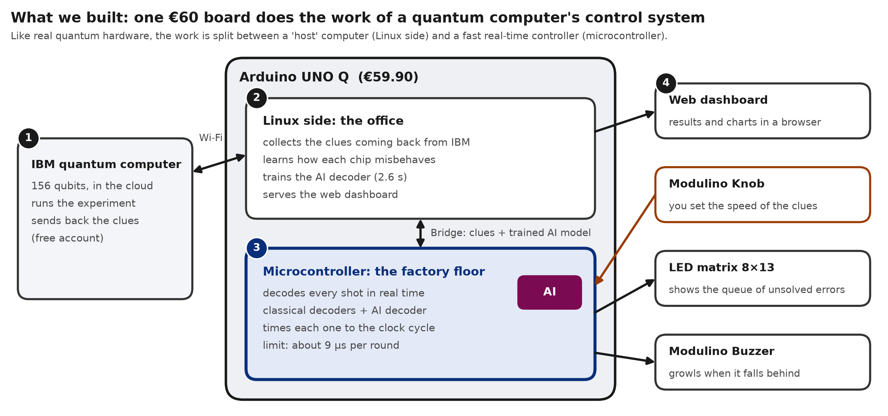
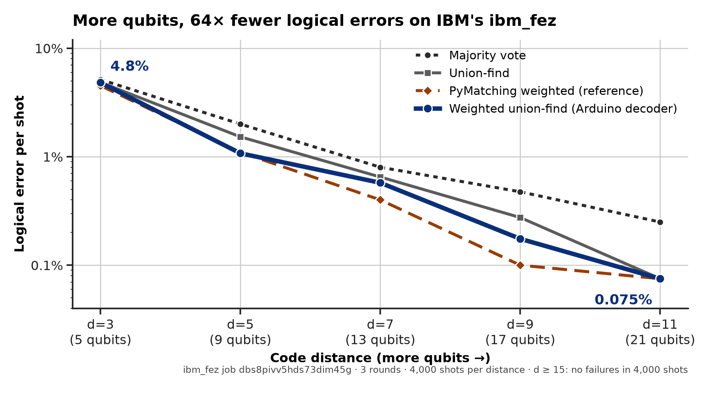

# QEC Edge Lab: €60 Arduino that corrects real quantum computer errors

**Junction Finland 2026 · Best use of Arduino UNO Q** · tags: Junction Finland 2026, Arduino UNO Q, Modulino, Edge AI, Quantum computing

> **In one sentence:** quantum computers make mistakes all the time, and a fast classical computer has to fix them
> on the fly. We built that "error fixer" on an Arduino UNO Q, tested it on real IBM quantum computers, and taught it
> with on-device AI to fix errors up to 9.5× better than the standard method.

**No quantum background needed to read this page.** The first part explains everything in plain words; the
technical details for experts are at the end.

---

## In 30 seconds

- **Real quantum hardware:** the Arduino sends experiments to IBM's 156-qubit quantum computers over the internet (free account).
- **The Arduino fixes the errors:** its small real-time processor works out which quantum bits went wrong, and measures exactly how long that takes.
- **Edge AI:** a small neural network trained *on the Arduino* learns the personality of each quantum chip and makes **up to 9× fewer mistakes** (typically 2–3×) than the best classical method.
- **You can feel the limit:** turn a knob to speed up the stream of errors; the LED matrix fills up and a buzzer growls when the Arduino can no longer keep up.

---

## Quantum computing in one minute (no physics needed)

**Quantum bits are fragile.** A normal computer bit is a 0 or a 1 and stays that way. A quantum bit (*qubit*) is so
sensitive that heat, stray signals or simply time make it flip by accident, on today's machines, a few times in
every hundred operations. Left alone, errors pile up and the result is garbage.

**The fix: redundancy and voting.** Imagine whispering a message across a noisy room. To be safe you say it with
several people at once, and the listener takes the majority. Quantum error correction does the same: one "logical"
bit of information is spread over many physical qubits.

**The catch: you can't just look.** Looking at a qubit destroys its quantum information. So instead, helper qubits
ask indirect questions such as *"are these two neighbours still the same?"*, over and over, every few microseconds.
The answers are clues; we call them **syndromes**.

**The detective: the decoder.** A classical computer reads the stream of clues and works out *which* qubits most
likely flipped, so they can be corrected. This program is called the **decoder**. It has to be:

1. **Accurate:**a wrong guess makes things worse, and
2. **Fast:** new clues arrive every round (about every microsecond on IBM machines). Like a supermarket cashier:
   if customers arrive faster than the cashier serves them, the queue grows forever.

**This project builds that decoder on an Arduino**, checks how accurate and how fast it is on real IBM data, and
uses AI to make it smarter.

---

## What we built



The Arduino UNO Q is two computers on one board, and that is exactly how real quantum computers are controlled:

| Part of the Arduino | Its job here | In everyday terms |
|---|---|---|
| **Linux side** (Qualcomm processor) | Talks to IBM, stores results, trains the AI, serves the web dashboard | The office: planning and paperwork |
| **Microcontroller** (STM32, 160 MHz) | Runs the decoders and times every one of them to the clock cycle | The factory floor: fast, precise, no interruptions |
| **8×13 LED matrix** | Shows progress, results, and the "queue" of unsolved errors | A live scoreboard |
| **Modulino Knob** | Sets how fast new error clues arrive | The speed dial |
| **Modulino Buzzer** | Growls when the decoder falls behind | The alarm |

## What you see and hear in the demo

1. **The scoreboard:** the dashboard shows real IBM results — as we use more qubits, the error rate drops (that's error correction working).
2. **The AI:** a pink line on the chart, the neural network trained on the Arduino beats the classical decoders.
3. **The speed test:** we turn the knob to send clues faster and faster. The Arduino keeps up… until about **9 microseconds per round**. Past that point the LED matrix fills with bars, the dashboard turns red and the buzzer growls: the queue of unsolved errors is exploding.

## Results in plain words



*How to read it:* left to right = more qubits protecting the information; down = fewer mistakes. The lines go
down, so error correction works on the real machine. **Blue** is the Arduino's classical decoder; **purple** is the
neural network trained on the Arduino. On small codes (5–13 qubits) the AI makes about 2× fewer mistakes (1.8–2.4×) than any
other decoder. On bigger codes it levels off at about 0.2–0.3%, where the classical decoders take over — so the best
design uses the AI for small codes and the classical decoder for large ones.

| What we found | Why it matters |
|---|---|
| **Error correction works on IBM's real chips:** spreading the information over 21 qubits instead of 5 cut mistakes from **4.8% to 0.075%** (64× fewer). | The core promise of quantum error correction, shown with a €60 board as the decoder. |
| **The AI decoder makes up to 9.5× fewer mistakes** (typically 2–3×) than the best classical decoder on small and medium codes (up to 17 qubits), on two different IBM chips. | Learning from data beats hand-written rules, and it runs on the Arduino itself. |
| **Why the AI wins:** on these chips a stored **1 fades into a 0 about 10–16× more often** than a 0 turns into a 1 (like a light bulb that dims, but never switches itself on). The AI learned this by itself from the data. | The Arduino doubles as a diagnostic tool: it discovered real physical behaviour of each chip, including one qubit that flips 31% of the time. |
| **Speed limit: about 9 microseconds per round** for the AI decoder on the Arduino, as fast as the fastest classical decoder we built. | Too slow for IBM's superconducting chips (~1 µs per round), but **fast enough for trapped-ion and neutral-atom quantum computers**, whose rounds take roughly 100 µs to a few milliseconds. |
| **We made the classical decoder 2.4–4× faster** on the microcontroller with identical answers. | Every microsecond counts in real-time control. |

## Who it helps

- **Students and teachers:** see, hear and *touch* quantum error correction on real hardware for the price of an Arduino.
- **Engineers building quantum computers:** a cheap bench to test how fast and accurate a decoder is on small embedded chips.
- **Researchers:** real measurements of how individual qubits on IBM chips misbehave, from a free account.

## Glossary

| Word | Meaning |
|---|---|
| **Qubit** | A quantum bit. Fragile: it can flip by accident. |
| **Physical vs logical qubit** | Physical = one real qubit on the chip. Logical = one protected bit of information spread over many physical qubits. |
| **Error correction** | Spreading information redundantly and repairing it as errors happen. |
| **Repetition code** | The simplest error-correcting code: store the same bit many times and keep checking that neighbours agree. |
| **Code distance (d)** | How many copies protect the bit. Bigger d = more qubits = more protection. |
| **Syndrome** | A clue: the answer to "are these two neighbours still the same?" |
| **Decoder** | The program that turns clues into a decision about what went wrong. |
| **Logical error rate** | How often the decoder still gets the final answer wrong. Lower is better. |
| **Round / round time (τ)** | One cycle of checking all neighbours; τ is how often a new round of clues arrives. |
| **Backlog** | Clues waiting to be decoded. If it keeps growing, the decoder is too slow. |
| **Union-find, matching (PyMatching)** | Two well-known classical decoder algorithms. PyMatching is the accurate reference used by researchers. |
| **T1 decay** | A qubit holding 1 slowly "relaxes" to 0, like a ball rolling downhill. |
| **IBM ibm_fez / ibm_marrakesh** | Two of IBM's 156-qubit quantum computers, available free via the cloud. |

---

# For experts: technical details

## How it works

1. **Accuracy on real hardware.** Bit-flip repetition codes at distance 3–25 (up to 49 qubits), 3 rounds of
   mid-circuit syndrome measurement, logical |0⟩ and |1⟩. A line of qubits with no SWAP gates is found on the
   chip; all 16 circuits go to IBM as one job (~6 s of QPU time). Shots are streamed to the STM32 over Bridge RPC,
   which decodes them and counts CPU cycles per decoder (DWT cycle counter, interrupts masked).
2. **Faster, smarter decoders.** A lazy-reset union-find runs 2.4–4× faster on the STM32 with identical results.
   The Linux side learns an error probability for every edge of the decoding graph from the syndromes
   ("p_ij" method), per logical state, and the STM32 uses them as integer weights. Runs are saved; old IBM jobs can
   be re-imported by ID without QPU time.
3. **Real-time backlog test.** Syndromes are bulk-loaded into STM32 RAM, then replayed as if one round arrived
   every τ, with interrupts on. The STM32 decodes in order and records latency and backlog. A sweep finds each
   decoder's limit τ* = mean decode time / rounds; in live mode the knob sets τ.
4. **Edge AI decoder** (below).

| Component | Role |
|---|---|
| Linux side (Qualcomm QRB2210, Debian) | Qiskit 2.x, qiskit-ibm-runtime, numpy; IBM jobs, saved runs, error-model learning, AI training, WebUI dashboard |
| STM32U585 (Cortex-M33, 160 MHz) | Decoders (majority, greedy, union-find naive/fast/weighted, AI), real-time replay engine, DWT cycle counter |
| Bridge RPC | Linux ↔ STM32 (msgpack); bulk loads only, never inside a timing measurement |

## Edge AI decoder

- **Model:** one hidden layer (detection events + final data bits → 32 ReLU units → 1 output; 400–4,000 parameters),
  trained in pure numpy on the board's Linux side (~2.6 s per model on the board), on held-out shots.
- **Inference on the STM32:** weights quantised to 15-bit integers, sent over Bridge with a checksum (a d=5 model is
  47 calls); integer arithmetic, **bit-exact with Python on every shot tested**; ~8.5 KB RAM. The first layer is
  additions only, because the inputs are bits.
- **Why it wins:** IBM hardware noise is strongly asymmetric (T1 decay of |1⟩); the network learns it from data,
  matching and union-find cannot represent it. A control network given only detection events does worse than union-find.
- **Where it loses:** at d ≥ 11 on ibm_fez it has an error floor of 0.15–0.4% (too few training shots for ~120 inputs),
  while graph decoders reach < 0.05%. A practical design: AI up to d=9, matching above.
- **Honest test:** 2-fold cross-fitting; the prepared state is only the training label, never an input (valid
  because both logical states are equally likely in the experiment).
- **Libraries considered:** TensorFlow Lite Micro (compile failures reported on the UNO Q core), Edge Impulse
  (supported, but needs a Studio/west build), emlearn (needs scikit-learn/Keras); a hand-written C MLP was the most robust.

| ibm_marrakesh, d | Best graph decoder | AI decoder |
|---|---|---|
| 3 | 10.6% (PyMatching weighted) | **6.3%** |
| 5 | 3.6% (PyMatching, mixed weights) | **1.8%** |
| 7 | 1.7% (PyMatching weighted) | **0.22%** |
| 9 | 0.47% (PyMatching weighted) | **0.05%** |

STM32 cost per AI decode: 1,909 cycles (11.9 µs) at d=3, 2,686 (16.8 µs) at d=5 — about the same as fast union-find.
Real-time replay (ibm_marrakesh, d=5): AI limit **8.7 µs per round**, tied with weighted union-find, fast UF 10.4 µs,
naive UF 19.8 µs. Second ibm_fez run: AI 2.8–3.2× fewer errors than the best graph decoder at d = 3–7.

## Key measurements

| Finding | Measured |
|---|---|
| Data error per round, \|0⟩ vs \|1⟩ | 0.3–1.2% vs 4.1–5.8% on ibm_fez (median 0.18% vs 3.4%); consistent with T1 decay |
| Worst qubit found | Qubit 82 on ibm_marrakesh: 31% error per round in \|1⟩ |
| Weighted vs uniform union-find | Up to 36% fewer logical errors (d=9, ibm_fez) |
| Fast vs naive union-find on the STM32 | 2.4–4× fewer cycles, identical results |
| Real-time limit on the STM32 | d=11: ~15 µs/round (fast UF), 41 µs (naive); d=5: 8.7 µs/round (AI) |
| Microbenchmark vs real-time replay | Replay ~1.5× slower (detector computation, unpacking, interrupts) |
| QPU time per experiment | ~6 s for 16 circuits |

All tables, generated from the raw data: [`results/results_tables.md`](results/results_tables.md).

## Repository layout

```
QEC_Edge_Lab_submission/
├── README.md                 this file
├── make_export.sh            refreshes code/ from the working app folders (never copies the API key)
├── code/
│   ├── qec_lab/              the main App Lab app
│   │   ├── python/           main.py (app), qec_common.py (graph, error model, run storage), qec_ai.py (AI decoder),
│   │   │                     requirements.txt, ibm_config.example.json
│   │   ├── sketch/           sketch.ino, qec_decoders.h (decoders), qec_rt.h (real-time replay), qec_ai.h (AI inference)
│   │   ├── assets/           web dashboard (index.html, app.js, style.css, libs/)
│   │   └── tools/            qec_offline.py (laptop: full statistics + PyMatching)
│   └── quantum_music/        earlier experiment: knob-controlled 5-qubit phase-estimation synth with dashboard
├── data/ibm_runs/            raw shots of the IBM runs (.npz + .json), board results, offline CSVs
├── results/results_tables.md all result tables, generated from data/
├── docs/                     demo script, submission checklist, background notes
└── media/                    architecture diagram, results chart, shot list for photos/video
```

## Build and run

1. Create a free IBM Quantum account (Open Plan); copy your API key and instance CRN. *(Optional: the
   "Noise model" mode works without any account.)*
2. In Arduino App Lab 0.12, create an app `qec_lab`, add the **WebUI - HTML** brick and the **Modulino** sketch library.
3. Copy `code/qec_lab/{python,sketch,assets}` into the app. **Add the brick first, then copy** (adding the brick resets `assets/`).
   Don't overwrite App Lab's own `app.yaml` and `sketch/sketch.yaml`.
4. Copy `python/ibm_config.example.json` to `python/ibm_config.json` and fill in your token and instance. Never publish it.
5. Connect the Modulino Knob and Buzzer (Qwiic) and run the app.
6. Open the dashboard on port 7000. If the Wi-Fi blocks device-to-device traffic: `ssh -N -L 7000:127.0.0.1:7000 arduino@<board-ip>`.
7. **Accuracy tab:** noise model first, then IBM hardware. **Real-time tab:** load a saved run, sweep, then live mode with the knob.
8. Full statistics on a laptop: `pip install numpy pymatching`, copy `python/runs/` from the board, run
   `python3 tools/qec_offline.py ./runs`.

## Limitations

- **Emulated real time:** real hardware syndromes are replayed on the STM32; the timing is real, but the loop with
  the quantum computer is not closed (the network adds milliseconds).
- **Too slow for superconducting qubits** (~9–15 µs vs ~1 µs per round); likely fast enough for trapped-ion and
  neutral-atom machines (rounds of roughly 100 µs to a few ms).
- **Repetition code only** (bit flips, not phase errors); 2-D codes are the next step.
- **STM32 statistics** use 400 shots per distance; full statistics (4,000) come from the laptop tool, which runs the
  same C decoder code.

## Credits and tools

Arduino UNO Q, Arduino App Lab, Modulino Knob and Buzzer; IBM Quantum (Qiskit, qiskit-ibm-runtime);
PyMatching (laptop reference decoder); socket.io client 4.7.5 (dashboard). Union-find decoding after
Delfosse & Nickerson; edge-probability estimation after the "p_ij" correlation method used in repetition-code
experiments.
